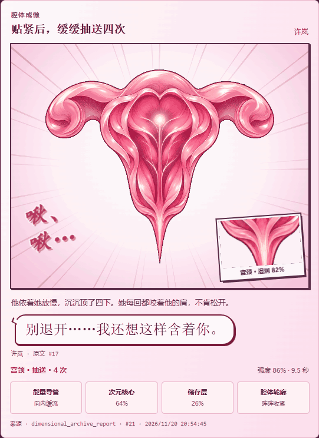

# 次元子宫 · DSH 粉色漫画看板

把当前 DSH 会话中已上报的角色反应画成漫画分镜。2.4 版采用樱花粉和草莓奶油色，保留褶皱深处的莓色墨线。主格与右下角的局部特写同步播放，动作次数、持续时间和引文均来自当前剧情。



## 安装

下载 [2.4.0 安装包](https://github.com/orphanEva/dimensional-womb/raw/refs/heads/main/dist/dsh-dimensional-archive-2.4.0.tgz)，在下载目录运行下面的命令，再重新打开同一 profile 的 DSH，从侧栏进入「次元子宫」。本版针对 DeepSeek Harness Web 0.2.2-rc.5 开发。

```sh
dsh plugin --profile web add ./dsh-dimensional-archive-2.4.0.tgz
```

从源码构建时，在仓库根目录运行 `node build.mjs` 生成客户端和独立预览，再运行 `pnpm pack` 生成安装包。

## 数据来源

DSH 宿主从已提交的会话事件生成 dimensionalArchiveV2 投影。打开面板只订阅当前会话，不向聊天发消息或修改角色。会话切换、刷新、重开时从宿主读数。回合数来自 turn/start，用户消息只计 user/message 中 source.kind 为 user 的条目。工具统计包含已结束的原生工具及 PTC 子调用。最近 50 条相关事件按宿主序号排列。

角色面板展示该会话最近一次成功回报的完整快照。显示来源、宿主事件序号和记录时间。快照中的储量与容量用于计算储存百分比；核心百分比控制模型中心亮度和动态节奏。速率、欲望、敏感度、导管状态、轮廓和上次满足时间均按快照显示。未提供的字段显示「未接入」，数值 0 单独显示。储量为上报时的值。旧版浏览器本地手动记录保留在原处，本版仅展示 DSH 数据。

## 剧情与其他插件对接

随包提供宿主工具 dimensional_archive_report。DSH 代理在剧情操作已经产生明确结果时可调用；代理实际可用工具由当前 DSH 预设决定。参数 role、action 为必填，其余字段只提交已知值，完整快照替换同会话的上一条。普通聊天不会自动推算角色数值。独立 HTML 显示未连接状态。

其他 DSH 工具也可在成功结果的 output.presentationMeta 中附带以下数据；宿主会从 tool/result 或 tool/ptc-dispatch 的 meta 中读取。此处给出的是接口示例。

```js
{ dimensionalArchive: { version: 1, source: 'my_roleplay_tool',
  status: { role:'示例角色', action:'周期结算', amount:48, capacity:200,
    rate:4, desire:60, sensitivity:70, core:32, conduit:'流入', contour:'舒张' } } }
```

欲望、敏感度与核心能量为 0～100，容量为正数，储量不能超过已知容量。satisfiedAt 为 Unix 毫秒。失败工具调用、格式错误的快照不会覆盖角色数据。Native 工具可在 meta 中署名来源，PTC 调用使用 DSH 记录的工具名。

## 局部反应与剧情原文

成像区跟随当前剧情的部位与节奏。按压时局部下陷，松开后逐渐回弹。抚触时高光沿受触部位移动。模型的湿润感由该部位上报的湿润度控制。反应期间，右下角会放大同一帧中受触部位的细节。成像下方可以同时展示一句身体描写与一句角色台词。下面以两个成年角色间的一次亲密互动为例，两段摘录均来自该回合正文。

```json
{
  "role": "岚",
  "action": "岚在爱人掌下高潮",
  "desire": 92,
  "sensitivity": 88,
  "reaction": { "part": "wall", "kind": "release", "intensity": 86, "durationMs": 6200, "moisture": 82 },
  "bodyLine": "岚把腰送进她掌心，湿热的内壁含着她的手指，紧一下，又紧一下。",
  "quote": "别抽出去……让我含着你缓一会儿。"
}
```

| 字段 | 上报约定 |
| --- | --- |
| part | left、right、core、wall、neck，分别对应左侧导管、右侧导管、核心、腔壁、宫颈 |
| kind | touch 轻触、press 按压、stroke 抚过、thrust 抽送、clench 夹紧、relax 舒展、peak 临界、release 释放、afterglow 余韵 |
| cycles | 仅适用于抽送或夹紧，1～16 的整数，表示整段时长内实际发生的次数。省略时显示一次动作 |
| intensity | 0～100，0 表示此次反应无可见强度 |
| durationMs | 200～60000 毫秒，从宿主提交该快照的时间开始计时 |
| moisture | 可选。0～100，表示本次反应部位的湿润度。仅在剧情工具有该读数时传入 |
| quote | 同一剧情事件中该角色的原话，可省略 |
| bodyLine | 同一剧情事件中对该角色身体感受或反应的一句原文，可省略 |
| sfx | 可选单行拟声词，最多 12 个 UTF-16 码元。与台词分开核对原文，核验成功后仅在本次局部反应有效时显示为漫画音效字 |

例如，一次已记录的操作是三次缓慢抽送，一共六秒。工具可上报 `{"part":"neck","kind":"thrust","cycles":3,"intensity":72,"durationMs":6000}`。看板在这六秒内表现三次推进与退回。若剧情记录的是腔壁夹紧，则使用 `part:"wall"` 与 `kind:"clench"` 表现向内收拢与松开。

动画按宿主事件时钟播放。切回看板时，仍在进行的反应从当前进度继续。反应结束后，摘录与读数保留到下一份角色快照，便于聊完再回看。切换会话会同步切换摘录。临界、释放和余韵分别由对应剧情操作触发。系统启用「减少动态效果」时以静态画面呈现。2.0 和 2.1 的已有快照仍可展示。

台词与身体描写分别核对，每条最多 120 个 UTF-16 码元。内置回报工具按本回合已提交的助手可见正文逐字核对，取最近四段文本各自末尾的 2048 个码元。其他工具上报的摘录须出现在该次成功结果的文本中。角色归属由上报方提供。只有核对成功的摘录才显示，并标注原文事件号。角色湿润度、动作强度、欲望值分别使用各自的上报值。

<details><summary>原画制作提示词（内置 ImageGen）</summary>

Restyle the attached square artwork as a glossy strawberry-milk pink Japanese doujin color plate for a mature fantasy romance manga. Keep the very same fantasy uterus/reproductive cavity front-view drawing and registration: identical silhouette, curling ducts and bright core at x49%, y31%, lower taper at x49%, y86%, same black #000000 background and margins. Re-ink the curves with delicate, tapered raspberry-pink pen strokes rather than heavy crimson contours. Give the inner folds a soft, plump, pearly feel; luminous pale sakura and milky petal pink as dominant midtones, candy strawberry and dusty mauve as shadow accents, milky ivory curved shine with a few slender glistening streaks following the folds. Sparse diagonal hatching and delicate, visible printed screentone in deepest shadows. Warm intimate adult doujin manga finish, expressive cel-painted color separations, lovely broad pink shapes immediately readable at thumbnail size. Pure black backdrop to composite in a game UI. Only the single registered artwork, no words, bubbles, border, figures or floating effects.

</details>
